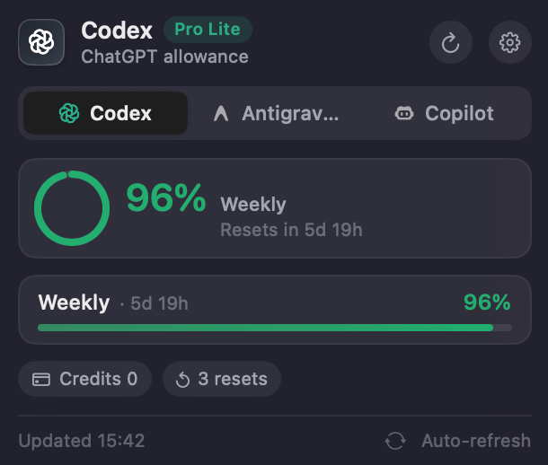
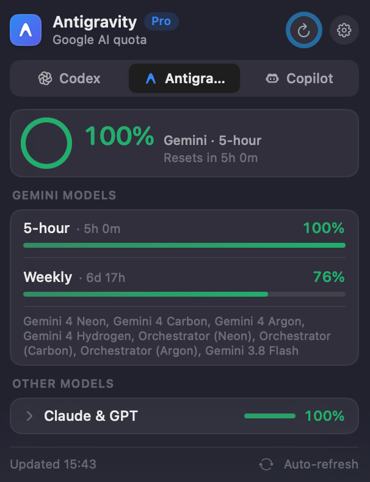
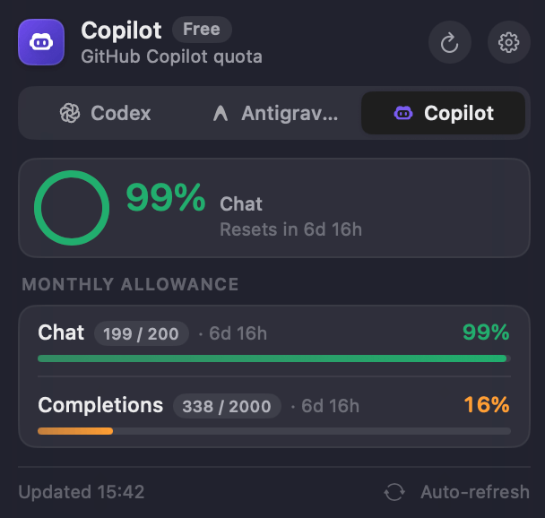

# AI Meter

A lightweight macOS menu bar app for monitoring AI coding tool usage limits and reset times.

## Supported tools

- **OpenAI Codex** (`codex` CLI)
- **Google Antigravity** (`agy` CLI)
- **GitHub Copilot** (`gh` CLI)

Automatically detects installed CLIs, shows one active readout in the menu bar, and lets you switch services from the popover (`⌘1`, `⌘2`, …).

## Screenshots

| Codex | Antigravity | Copilot |
| --- | --- | --- |
|  |  |  |

## Requirements

- macOS 13+
- Swift 6+ (`xcode-select --install`)
- At least one supported CLI signed in (`codex login`, `agy`, or `gh auth login`)

## Build & install

```sh
./scripts/build.sh
mkdir -p ~/Applications
cp -R "dist/AI Meter.app" ~/Applications/
open ~/Applications/"AI Meter.app"
```

## Test

```sh
./scripts/test.sh
```
